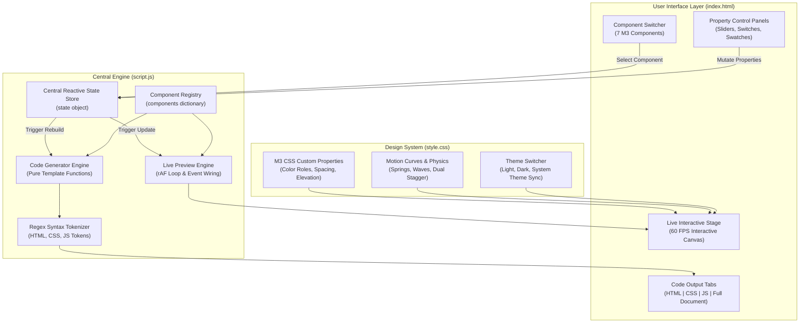

# Material 3 Playground

<div align="center">

[](https://m3.material.io/)
[-brightgreen?style=for-the-badge)](https://developer.mozilla.org/en-US/docs/Web/JavaScript)
[](https://developer.mozilla.org/)
[](https://www.w3.org/WAI/standards-guidelines/wcag/)
[](LICENSE)

<br/>

**The ultimate standalone developer playground and code generator for Google's Material Design 3 guidelines.**  
Crafted 100% in pure vanilla **HTML**, **CSS**, and **JavaScript** — absolutely zero frameworks, bundlers, external npm modules, or runtime dependencies.

[Explore Components](#included-components) • [Component Matrix](#component-feature-matrix) • [Design Tokens](#design-tokens--motion-system) • [Architecture](#architecture--system-design) • [Quick Start](#getting-started) • [Production Recipes](#production-code-recipes) • [Roadmap](#future-roadmap)

</div>

---

> [!NOTE]
> **Disclaimer:** This is an independent, community-driven developer tool inspired by Google's official [Material Design 3 (M3) specifications](https://m3.material.io/). It is not sponsored, owned, or endorsed by Google LLC or the Material Design core team.
>
> **Official Material Design 3 Documentation:**
> - [Material 3 Progress Indicators](https://m3.material.io/components/progress-indicators/overview)
> - [Material 3 Loading Indicators](https://m3.material.io/components/loading-indicator/overview)
> - [Material 3 All Buttons](https://m3.material.io/components/all-buttons/overview)
> - [Material 3 Floating Action Button (FAB)](https://m3.material.io/components/floating-action-button/overview)
> - [Material 3 Menus & Exposed Dropdowns](https://m3.material.io/components/menus/overview)

---

## Table of Contents

- [Why Material 3 Playground?](#why-material-3-playground)
- [Included Components](#included-components)
  - [1. Expressive Loading Indicator](#1-expressive-loading-indicator)
  - [2. Linear Progress Indicator (Standard & Wavy)](#2-linear-progress-indicator-standard--wavy)
  - [3. Circular Progress Indicator (Standard & Wavy)](#3-circular-progress-indicator-standard--wavy)
  - [4. Common Buttons](#4-common-buttons)
  - [5. Floating Action Button (FAB)](#5-floating-action-button-fab)
  - [6. Dropdown Menus (Exposed Select & Action Menus)](#6-dropdown-menus-exposed-select--action-menus)
  - [7. FAB Menu (Speed Dial / Expandable FAB)](#7-fab-menu-speed-dial--expandable-fab)
- [Component Feature Matrix](#component-feature-matrix)
- [Design Tokens & Motion System](#design-tokens--motion-system)
  - [M3 Color Roles](#color-role-system)
  - [Motion Physics & Easing Presets](#motion-physics--easing-presets)
  - [Elevation & Surface Tint Levels](#elevation--surface-tint-levels)
  - [Corner Radii & Shape Scale](#corner-radii--shape-scale)
- [Architecture & System Design](#architecture--system-design)
- [Getting Started](#getting-started)
- [Production Code Recipes](#production-code-recipes)
  - [Recipe 1: Expressive Wavy Circular Progress (SVG/CSS)](#recipe-1-expressive-wavy-circular-progress-svgcss)
  - [Recipe 2: Speed Dial FAB Menu with Spring Physics & Dual Stagger](#recipe-2-speed-dial-fab-menu-with-spring-physics--dual-stagger)
- [Accessibility (a11y) & WCAG Compliance](#accessibility-a11y--wcag-compliance)
- [Framework Integration Guide](#framework-integration-guide)
- [Future Roadmap](#future-roadmap)
- [Browser Support](#browser-support)
- [License](#license)

---

## Why Material 3 Playground?

Modern web developers frequently struggle to implement authentic Material 3 UI elements because official libraries often pull hundreds of kilobytes of dependencies, require heavy Node toolchains, or fall behind on Expressive specifications (such as undulating wave geometries, dual-directional stagger cascades, and shape-morphing SMIL animations).

**Material 3 Playground** solves this by offering:

1. **Zero Runtime Weight**: Every component is implemented in standard HTML5, CSS3 Custom Properties, and ES2022 JavaScript.
2. **Instant Visual Tuning**: Adjust speeds, stroke thickness, wave cycles, corner radii, elevation depths, spring curves, and color palettes live with immediate 60 FPS canvas feedback.
3. **Dual Output Engines**: Generate either **Pure CSS** (100% JavaScript-free, using `:focus-within`, SVG morphing, and CSS animations) or **Vanilla JS** (with keyboard trapping, focus restore, and click-coordinate ripples).
4. **Copy-and-Paste Ready**: Get self-contained HTML, CSS, JS, or standalone full HTML documents ready to paste into any web app, static site generator, or component framework.
5. **Strict Spec Fidelity**: Built according to canonical Material Design 3 guidelines, including state layers (hover, focus, active press), dual-delay reverse staggers, and responsive dark/light color schemes.

---

## Included Components

### 1. Expressive Loading Indicator
The Material 3 Expressive Loading Indicator replaces legacy circular spinners with organic, fluid polygon shape-morphing transitions tailored for indeterminate operations (<5 seconds).

- **Continuous 7-Shape Morphing Loop**: Smoothly interpolates through canonical Material 3 polygon geometries:
  $$\text{Soft Burst} \longrightarrow \text{Cookie 9-Sided} \longrightarrow \text{Pentagon} \longrightarrow \text{Pill} \longrightarrow \text{Sunny} \longrightarrow \text{Cookie 4-Sided} \longrightarrow \text{Oval}$$
- **Single Shape Freeze / Rotate**: Freeze any single canonical shape (including *Circle*, *Squircle*, *Flower*, *Heart*, and *Triangle*) with continuous clockwise or counter-clockwise spin.
- **Container Presentation**:
  - *Uncontained*: Standalone floating glyph.
  - *Contained*: Tonal surface container tile with rounded corner radius and elevation depth.
- **Styling Styles**: *Filled* (solid fill with primary role) and *Outlined* (custom stroke thickness from 1.5px to 8px).
- **Dual Execution Engines**:
  - **Pure CSS/SVG (SMIL)**: Declarative `<animate>` element path transitions running off the main thread.
  - **Vanilla JS (`requestAnimationFrame`)**: Cubic Bézier coordinate matrix blending for high-precision real-time interpolation.

---

### 2. Linear Progress Indicator (Standard & Wavy)
Material 3 Linear Progress indicators visualize task completion along a horizontal bar with pill-rounded caps, supporting both standard tracks and the new undulating wavy variant.

- **Operating Modes**:
  - **Indeterminate**: Dual-segment phase-shifted animation with authentic M3 deceleration curves:
    - Primary indicator (`m3-primary-indeterminate-translate`, `m3-primary-indeterminate-scale`)
    - Secondary trailing indicator (`m3-secondary-indeterminate-translate`, `m3-secondary-indeterminate-scale`)
  - **Determinate**: Precision progress visualization (0% to 100%) with 4dp stop indicator dot.
- **Visual Geometries**:
  - **Standard Track**: Clean pill bar with background track container.
  - **Wavy Expressive**: Sinusoidal path geometry with customizable amplitude ($2\text{px} \le A \le 14\text{px}$) and wavelength ($16\text{px} \le \lambda \le 64\text{px}$), scrolling seamlessly or clipping via `stroke-dashoffset`.
- **Expressive 4-Color Cycle**: Optional continuous four-color indeterminate animation cycling across Material 3 tonal palettes:
  $$\text{Primary} \longrightarrow \text{Teal} \longrightarrow \text{Tertiary} \longrightarrow \text{Error}$$
- **Customizable Dimensions**: Bar thickness from 2px to 16px; layout width from 160px to 560px.
- **Engines**: Pure CSS declarative keyframes or interactive Vanilla JS controller class.

---

### 3. Circular Progress Indicator (Standard & Wavy)
Circular progress indicators visualize background activity or quantitative metrics via circular motion, featuring the new Material 3 Expressive polar wave ring.

- **Operating Modes**:
  - **Indeterminate**: Rotating spinner with expanding and collapsing arc keyframes (`m3-circular-rotate`, `m3-circular-dash`).
  - **Determinate**: Quantitative gauge (0% to 100%) mapped directly to SVG `stroke-dashoffset`.
- **Visual Geometries**:
  - **Standard Circular**: Classic circular arc with rounded caps and subtle background track ring.
  - **Wavy Expressive**: Mathematical polar wave ring generated via the sinusoidal radius function:
    $$r(\theta) = R_0 + A \cdot \sin(N \cdot \theta + \phi)$$
    where $R_0$ is base radius, $A$ is wave amplitude ($2\text{px} \dots 10\text{px}$), $N$ is petal cycle frequency ($3 \dots 12$), and $\phi$ is rotation phase.
- **Track Shape Sync**: Track circle can render as a matching wavy background or a concentric smooth circle.
- **Canonical Presets**: Small (24px), Default (48px), Hero (112px/120px) diameters with stroke weights from 2px (Thin) to 12px (Bold).
- **Engines**: Pure CSS/SVG or Vanilla JS controller (`createM3CircularProgress`).

---

### 4. Common Buttons
Communicate discrete actions that users can trigger, structured with clear Material 3 visual hierarchy.

- **5 Material 3 Hierarchy Variants**:
  - **Filled**: High-emphasis primary container (`--md-sys-color-primary`).
  - **Elevated**: High-emphasis filled button on a surface with Level 1 shadow, rising to Level 2 on hover.
  - **Tonal**: Medium-emphasis secondary action container (`--md-sys-color-secondary-container`).
  - **Outlined**: Medium-emphasis button with a 1px boundary stroke (`--md-sys-color-outline`).
  - **Text**: Low-emphasis action with no container fill or boundary border.
- **Icon Placement**: *None*, *Leading icon* (before label), or *Trailing icon* (after label) with automatic 8dp spacing.
- **Density & Sizing**: *Small* (32dp), *Medium* (40dp standard), and *Large* (48dp).
- **Corner Radii**: *Full Pill* (9999px canonical M3), *Rounded* (12dp), and *Subtle* (4dp).
- **State Layers & Interactions**:
  - Pure CSS state overlays using `::before` (Hover 8% opacity, Focus 12% opacity, Active 12% opacity).
  - Optional Vanilla JS radial ink ripple originating directly from user pointer click coordinates $(x, y)$.

---

### 5. Floating Action Button (FAB)
The primary or most prominent action on a screen, floating on top of all application content.

- **4 Standard Sizes**:
  - **Standard FAB**: 56×56dp with 16dp rounded corners and 24dp icon.
  - **Small FAB**: 40×40dp with 12dp rounded corners for secondary actions or compact layouts.
  - **Large FAB**: 96×96dp with 28dp rounded corners and 36dp hero icon.
  - **Extended FAB**: 56dp height with 16dp corners, leading icon, and customizable text label.
- **Tonal Color Roles**: *Surface* (`#ece6f0`), *Primary* (`#eaddff`), *Secondary* (`#e8def8`), *Tertiary* (`#ffd8e4`).
- **Elevation System**:
  - **Standard**: Level 3 resting shadow (6dp) elevating to Level 4 on hover (8dp).
  - **Lowered**: Level 1 resting shadow (1dp) elevating to Level 2 on hover (3dp) for high-density pages.

---

### 6. Dropdown Menus (Exposed Select & Action Menus)
Temporary surfaces that emerge when users interact with an anchor button or text input field.

- **4 Anchor & Trigger Archetypes**:
  - **Exposed Filled**: Text field select trigger with surface container fill, active indicator bottom bar, and floating label.
  - **Exposed Outlined**: Text field select trigger with 1px border stroke and floating label cutout.
  - **Action Button**: Pill-shaped button trigger with trailing chevron.
  - **Icon Button**: Minimal circular 3-dots (`more_vert`) trigger for overflow action menus.
- **Menu Features & Slots**:
  - Presets: *Fruits & Produce*, *User Account* (with Profile, Settings, Sign Out), and *Action Tools* (Edit, Duplicate, Share, Delete).
  - Item slots for 24dp leading icons, text labels, trailing keyboard shortcuts (`⌘P`, `⌘E`), and dividers.
  - Surface Level 2 elevation shadow, 4dp corners, and optional scrollable max-height (200px).
  - Trailing chevron that smoothly rotates 180° upon menu expansion.
- **Dual Execution Engines**:
  - **Vanilla JS**: Interactive click-to-open, selection sync, click-outside listener, and Escape key dismissal.
  - **Pure CSS**: Declarative `:focus-within` expansion with CSS transitions and zero JavaScript.

---

### 7. FAB Menu (Speed Dial / Expandable FAB)
Reveals a cascading sequence of related quick actions when tapped, enabling multiple operations from a single floating trigger.

- **Primary Anchor FAB & Micro-Animations**:
  - 56×56dp container with 16dp corner radius and Level 3 elevation shadow.
  - Click-compression bounce (`scale(0.92)` on active press, `scale(1.05)` on hover) and corner radius morphing ($16\text{px} \to 20\text{px}$).
  - Customizable trigger icon rotation: **45°** ($+$ to $\times$), **135°** (spin turn), or **225°** (dynamic full spin) with spring easing.
- **Smooth Animation Physics & Easing Presets**:
  - **Spring**: Expressive Material 3 elastic spring with natural overshoot bounce (`cubic-bezier(0.34, 1.4, 0.64, 1)`).
  - **Emphasized**: Material 3 Emphasized deceleration curve for snappy responsiveness (`cubic-bezier(0.05, 0.7, 0.1, 1.0)`).
  - **Gentle**: Smooth cinematic glide with subtle momentum (`cubic-bezier(0.25, 1, 0.5, 1)`).
- **Dual-Directional Stagger Cascades**:
  - **Forward Entrance Delay**: Action items blossom outwards sequentially:
    $$\Delta t_{\text{enter}}(i) = i \cdot \tau_{\text{stagger}}$$
  - **Reverse Collapse Delay**: Items retract in reverse order, top closing first:
    $$\Delta t_{\text{exit}}(i) = (N - 1 - i) \cdot (\tau_{\text{stagger}} \cdot 0.65)$$
  - Optional **Blossom Micro-Rotation** ($-12^\circ \to 0^\circ$ leveling transition).
- **Action Items & Pill Labels**:
  - 40×40dp mini action buttons with 12dp rounded corners and hover pop (`scale(1.12)`).
  - High-contrast text pill labels with slide-and-fade entrance (`translateX(8px) scale(0.92)` $\to$ `translateX(0) scale(1)`) and hover float reaction (`translateX(-2px) scale(1.02)`).
- **Layout Directions**:
  - **Upwards (Vertical Stack)**: Canonical vertical column above the trigger FAB.
  - **Horizontal Row**: Expands actions horizontally to the side for wide screens.
- **Canonical Presets**: *Create*, *Share*, *Tasks* with icons and labels.
- **Backdrop Scrim Overlay**: Smooth fade overlay with `backdrop-filter: blur(2px)` and click-to-dismiss behavior.
- **Engines**: Vanilla JS interactive controller or Pure CSS `:focus-within` controller.

---

## Component Feature Matrix

| Component | Variants / Types | Sizes & Densities | Color Roles | Physics & Motion | a11y & ARIA | Pure CSS Mode |
| :--- | :--- | :--- | :--- | :--- | :--- | :---: |
| **Loading Indicator** | Morph, Single-Shape, Contained, Outlined | 24px – 96px | Any hex / Tonal | SMIL morph / rAF | `role="status"` | ✅ |
| **Linear Progress** | Standard, Wavy Expressive | 160px – 560px (2–16px stroke) | Primary, 4-Color Cycle | M3 Indeterminate Curves | `role="progressbar"` | ✅ |
| **Circular Progress** | Standard, Wavy Polar Ring | 24px, 48px, 112px, 120px (2–12px stroke) | Primary, 4-Color Cycle | Polar Sine Undulation | `role="progressbar"` | ✅ |
| **Common Buttons** | Filled, Elevated, Tonal, Outlined, Text | Small (32dp), Med (40dp), Large (48dp) | Primary, Secondary, Tonal | State Layers, Radial Ink | `role="button"` | ✅ |
| **Floating Action Button** | Standard, Small, Large, Extended | 40dp, 56dp, 96dp | Surface, Primary, Secondary, Tertiary | Hover Lift, Active Press | `role="button"` | ✅ |
| **Dropdown Menus** | Filled, Outlined, Action, Icon Menu | Compact, Standard, Scrollable (200px) | Surface Tonal Level 2 | 180° Chevron, ScaleY | `role="menu"`, `listbox` | ✅ |
| **FAB Menu (Speed Dial)** | Upwards Stack, Horizontal Row | 56dp Trigger + 40dp Mini-FABs | Primary, Secondary, Tertiary, Surface | Spring, Dual Stagger, Blur | `role="menu"`, `aria-expanded` | ✅ |

---

## Design Tokens & Motion System

### Color Role System

Material 3 uses a tonal role architecture that maps semantic intent onto dynamic color values:

```css
:root {
  /* Primary Role */
  --md-sys-color-primary: #6750A4;
  --md-sys-color-on-primary: #FFFFFF;
  --md-sys-color-primary-container: #EADDFF;
  --md-sys-color-on-primary-container: #21005D;

  /* Secondary Role */
  --md-sys-color-secondary: #625B71;
  --md-sys-color-on-secondary: #FFFFFF;
  --md-sys-color-secondary-container: #E8DEF8;
  --md-sys-color-on-secondary-container: #1D192B;

  /* Tertiary Role */
  --md-sys-color-tertiary: #7D5260;
  --md-sys-color-on-tertiary: #FFFFFF;
  --md-sys-color-tertiary-container: #FFD8E4;
  --md-sys-color-on-tertiary-container: #31111D;

  /* Surface & Background */
  --md-sys-color-surface: #FEF7FF;
  --md-sys-color-surface-container: #F3EDF7;
  --md-sys-color-surface-container-high: #ECE6F0;
  --md-sys-color-outline: #79747E;
}
```

### Motion Physics & Easing Presets

Material 3 motion is expressive, natural, and informative. The playground incorporates official cubic-bezier easing tokens and spring overshoot dynamics:

| Motion Token | Easing Cubic Bézier | Characteristics & Best Use |
| :--- | :--- | :--- |
| **Emphasized Decelerate** | `cubic-bezier(0.05, 0.7, 0.1, 1.0)` | Canonical M3 curve for incoming elements arriving on screen. |
| **Emphasized Accelerate** | `cubic-bezier(0.3, 0.0, 0.8, 0.15)` | Fast acceleration for elements departing off-screen. |
| **Standard Decelerate** | `cubic-bezier(0.2, 0.0, 0.0, 1.0)` | Balanced transition for continuous state changes. |
| **Expressive Spring** | `cubic-bezier(0.34, 1.4, 0.64, 1.0)` | Elastic bounce with organic overshoot for Speed Dial expansion. |
| **Gentle Glide** | `cubic-bezier(0.25, 1.0, 0.5, 1.0)` | Cinematic glide with subtle momentum and soft settling. |

### Elevation & Surface Tint Levels

Elevation in Material 3 is represented by combined drop shadows and tonal color shifts:

- **Level 0 (0dp)**: Flat surface, no shadow.
- **Level 1 (1dp)**: `box-shadow: 0 1px 3px 1px rgba(0,0,0,0.15), 0 1px 2px rgba(0,0,0,0.30)` (Cards, Lowered FAB).
- **Level 2 (3dp)**: `box-shadow: 0 2px 6px 2px rgba(0,0,0,0.15), 0 1px 2px rgba(0,0,0,0.30)` (Menus, Hovered Lowered FAB).
- **Level 3 (6dp)**: `box-shadow: 0 4px 8px 3px rgba(0,0,0,0.15), 0 1px 3px rgba(0,0,0,0.30)` (Resting FAB, Speed Dial Trigger).
- **Level 4 (8dp)**: `box-shadow: 0 6px 10px 4px rgba(0,0,0,0.15), 0 2px 3px rgba(0,0,0,0.30)` (Hovered FAB).
- **Level 5 (12dp)**: `box-shadow: 0 8px 12px 6px rgba(0,0,0,0.15), 0 4px 4px rgba(0,0,0,0.30)` (Dialogs, Pickers).

### Corner Radii & Shape Scale

- **None (0dp)**: Sharp square corners.
- **Extra Small (4dp)**: Dropdown menus, text field indicator lines.
- **Small (8dp)**: Pill label overlays, chips.
- **Medium (12dp)**: Mini action buttons, medium cards.
- **Large (16dp)**: Standard FABs, active speed dial trigger ($16\text{px} \to 20\text{px}$ morph).
- **Extra Large (28dp)**: Large FABs, dialog surfaces.
- **Full Pill (9999px)**: Common buttons, progress indicator caps, extended FABs.

---

## Architecture & System Design

The entire playground operates client-side with clean unidirectional data flow:



### Core Subsystems in `script.js`

1. **State Store (`state`)**: Central reactive object maintaining component selections, colors, dimensions, animation speeds, easing presets, and active preview modes.
2. **Component Registry (`components`)**: Pluggable interface defining each component with:
   - `initPreview(container)` & `renderPreview(container)`
   - `generateHTML(state)`
   - `generateCSS(state)`
   - `generateJS(state)`
   - `generateFullDocument(state)`
3. **Syntax Highlighter (`highlighter`)**: Zero-dependency tokenizer utilizing regex pattern matching for tags, attributes, keywords, properties, strings, numbers, and comments.
4. **Clipboard & Export (`setupClipboard`)**: Copies code with Material 3 feedback snackbars and generates downloadable standalone `.html` bundles.
5. **Theme Manager (`setupTheme`)**: Light, dark, and system preference detection with `prefers-color-scheme` listeners.

---

## Getting Started

### Option 1: Direct File Opening (No Server Needed)
Simply double-click [index.html](file:///home/denisvarga/Projects/material_playground/index.html) or drag it into any modern web browser.

### Option 2: Local Static Web Server

```bash
# Using Python 3 (built-in on macOS & Linux)
python3 -m http.server 8080

# Using Node.js (npx)
npx serve . -p 8080

# Using PHP (built-in)
php -S localhost:8080
```

Then visit `http://localhost:8080` in your browser.

---

## Production Code Recipes

All code generated by this playground is **100% self-contained** and ready for production without external scripts or stylesheet links.

### Recipe 1: Expressive Wavy Circular Progress (SVG/CSS)

```html
<!-- Material 3 Expressive Wavy Circular Progress Indicator (Pure CSS) -->
<div class="m3-circular-progress m3-circular-progress--wavy" role="progressbar" aria-label="Loading content" aria-busy="true">
  <svg viewBox="0 0 112 112" width="112" height="112">
    <!-- Background Track -->
    <path class="m3-circular-progress__track"
          d="M 56 12 C 60 12, 62 16, 66 16 C 70 16, 73 13, 77 14 C 81 15, 83 20, 87 22 C 91 24, 95 23, 98 26 C 101 29, 100 34, 102 38 C 104 42, 108 44, 109 49 C 110 54, 107 58, 107 63 C 107 68, 110 72, 109 77 C 108 82, 104 84, 102 88 C 100 92, 101 97, 98 100 C 95 103, 91 102, 87 104 C 83 106, 81 111, 77 112 C 73 113, 70 110, 66 110 C 62 110, 60 114, 56 114 C 52 114, 50 110, 46 110 C 42 110, 39 113, 35 112 C 31 111, 29 106, 25 104 C 21 102, 17 103, 14 100 C 11 97, 12 92, 10 88 C 8 84, 4 82, 3 77 C 2 72, 5 68, 5 63 C 5 58, 2 54, 3 49 C 4 44, 8 42, 10 38 C 12 34, 11 29, 14 26 C 17 23, 21 24, 25 22 C 29 20, 31 15, 35 14 C 39 13, 42 16, 46 16 C 50 16, 52 12, 56 12 Z"
          fill="none" stroke="#E6E0E9" stroke-width="7" stroke-linecap="round" />
    <!-- Active Indeterminate Indicator -->
    <path class="m3-circular-progress__indicator"
          d="M 56 12 C 60 12, 62 16, 66 16 C 70 16, 73 13, 77 14 C 81 15, 83 20, 87 22 C 91 24, 95 23, 98 26 C 101 29, 100 34, 102 38 C 104 42, 108 44, 109 49 C 110 54, 107 58, 107 63 C 107 68, 110 72, 109 77 C 108 82, 104 84, 102 88 C 100 92, 101 97, 98 100 C 95 103, 91 102, 87 104 C 83 106, 81 111, 77 112 C 73 113, 70 110, 66 110 C 62 110, 60 114, 56 114 C 52 114, 50 110, 46 110 C 42 110, 39 113, 35 112 C 31 111, 29 106, 25 104 C 21 102, 17 103, 14 100 C 11 97, 12 92, 10 88 C 8 84, 4 82, 3 77 C 2 72, 5 68, 5 63 C 5 58, 2 54, 3 49 C 4 44, 8 42, 10 38 C 12 34, 11 29, 14 26 C 17 23, 21 24, 25 22 C 29 20, 31 15, 35 14 C 39 13, 42 16, 46 16 C 50 16, 52 12, 56 12 Z"
          fill="none" stroke="#6750A4" stroke-width="7" stroke-linecap="round" />
  </svg>
</div>

<style>
.m3-circular-progress {
  display: inline-flex;
  align-items: center;
  justify-content: center;
  animation: m3-circular-rotate 1.4s linear infinite;
}

.m3-circular-progress__indicator {
  stroke-dasharray: 280;
  stroke-dashoffset: 280;
  transform-origin: center;
  animation: m3-circular-dash 1.4s cubic-bezier(0.4, 0, 0.2, 1) infinite;
}

@keyframes m3-circular-rotate {
  to { transform: rotate(360deg); }
}

@keyframes m3-circular-dash {
  0% {
    stroke-dashoffset: 280;
    transform: rotate(0deg);
  }
  50% {
    stroke-dashoffset: 70;
    transform: rotate(180deg);
  }
  100% {
    stroke-dashoffset: 280;
    transform: rotate(360deg);
  }
}

@media (prefers-reduced-motion: reduce) {
  .m3-circular-progress,
  .m3-circular-progress__indicator {
    animation: none;
    stroke-dashoffset: 140;
  }
}
</style>
```

---

### Recipe 2: Speed Dial FAB Menu with Spring Physics & Dual Stagger

```html
<!-- Material 3 Speed Dial / Expandable FAB Menu -->
<div class="m3-fab-menu m3-fab-menu--primary m3-fab-menu--upwards" id="m3-speed-dial">
  <div class="m3-fab-menu__scrim" aria-hidden="true"></div>
  <ul class="m3-fab-menu__items" role="menu" aria-label="Quick actions menu">
    <li class="m3-fab-menu__item" role="none" style="--item-index: 0; --item-reverse-index: 2;">
      <span class="m3-fab-menu__label" id="fab-label-0">New Document</span>
      <button class="m3-fab-menu__action" type="button" role="menuitem" aria-labelledby="fab-label-0">
        <svg viewBox="0 0 24 24" width="20" height="20" fill="currentColor"><path d="M14 2H6c-1.1 0-2 .9-2 2v16c0 1.1.9 2 2 2h12c1.1 0 2-.9 2-2V8l-6-6zm2 16H8v-2h8v2zm0-4H8v-2h8v2zm-3-5V3.5L18.5 9H13z"/></svg>
      </button>
    </li>
    <li class="m3-fab-menu__item" role="none" style="--item-index: 1; --item-reverse-index: 1;">
      <span class="m3-fab-menu__label" id="fab-label-1">Take Photo</span>
      <button class="m3-fab-menu__action" type="button" role="menuitem" aria-labelledby="fab-label-1">
        <svg viewBox="0 0 24 24" width="20" height="20" fill="currentColor"><circle cx="12" cy="12" r="3.2"/><path d="M9 2L7.17 4H4c-1.1 0-2 .9-2 2v12c0 1.1.9 2 2 2h16c1.1 0 2-.9 2-2V6c0-1.1-.9-2-2-2h-3.17L15 2H9zm3 15c-2.76 0-5-2.24-5-5s2.24-5 5-5 5 2.24 5 5-2.24 5-5 5z"/></svg>
      </button>
    </li>
    <li class="m3-fab-menu__item" role="none" style="--item-index: 2; --item-reverse-index: 0;">
      <span class="m3-fab-menu__label" id="fab-label-2">Attach File</span>
      <button class="m3-fab-menu__action" type="button" role="menuitem" aria-labelledby="fab-label-2">
        <svg viewBox="0 0 24 24" width="20" height="20" fill="currentColor"><path d="M16.5 6v11.5c0 2.21-1.79 4-4 4s-4-1.79-4-4V5a2.5 2.5 0 0 1 5 0v10.5c0 .83-.67 1.5-1.5 1.5s-1.5-.67-1.5-1.5V6H9v9.5a3.5 3.5 0 0 0 7 0V5c0-2.21-1.79-4-4-4S5 2.79 5 5v12.5c0 3.31 2.69 6 6 6s6-2.69 6-6V6h-1.5z"/></svg>
      </button>
    </li>
  </ul>
  <button class="m3-fab-menu__trigger" type="button" aria-haspopup="true" aria-expanded="false" aria-label="Toggle quick actions">
    <span class="m3-fab-menu__icon" aria-hidden="true">
      <svg viewBox="0 0 24 24" width="24" height="24" fill="currentColor"><path d="M19 13h-6v6h-2v-6H5v-2h6V5h2v6h6v2z"/></svg>
    </span>
  </button>
</div>

<style>
.m3-fab-menu {
  --m3-fab-primary-bg: #6750A4;
  --m3-fab-primary-fg: #FFFFFF;
  --m3-fab-action-bg: #E8DEF8;
  --m3-fab-action-fg: #1D192B;
  --m3-fab-label-bg: #F7F2FA;
  --m3-fab-label-fg: #1D192B;
  --m3-fab-duration: 350ms;
  --m3-fab-spring: cubic-bezier(0.34, 1.4, 0.64, 1);
  --m3-fab-close-curve: cubic-bezier(0.4, 0, 0.2, 1);
  --m3-fab-stagger: 40ms;

  position: fixed;
  bottom: 24px;
  right: 24px;
  display: inline-flex;
  flex-direction: column;
  align-items: flex-end;
  font-family: system-ui, -apple-system, sans-serif;
  user-select: none;
  z-index: 1000;
}

/* Scrim Blur */
.m3-fab-menu__scrim {
  position: fixed;
  inset: 0;
  background: rgba(0, 0, 0, 0.32);
  backdrop-filter: blur(2px);
  opacity: 0;
  pointer-events: none;
  transition: opacity 250ms ease;
  z-index: 1;
}
.m3-fab-menu--open .m3-fab-menu__scrim { opacity: 1; pointer-events: auto; }

/* Primary FAB Trigger */
.m3-fab-menu__trigger {
  position: relative;
  width: 56px;
  height: 56px;
  border-radius: 16px;
  border: none;
  background: var(--m3-fab-primary-bg);
  color: var(--m3-fab-primary-fg);
  cursor: pointer;
  box-shadow: 0 4px 8px 3px rgba(0,0,0,0.15), 0 1px 3px rgba(0,0,0,0.30);
  transition: transform 200ms var(--m3-fab-spring), border-radius 200ms ease;
  z-index: 5;
}
.m3-fab-menu__trigger:hover { transform: scale(1.05); }
.m3-fab-menu__trigger:active { transform: scale(0.92); }
.m3-fab-menu--open .m3-fab-menu__trigger { border-radius: 20px; }

/* Trigger Icon Spring Rotation */
.m3-fab-menu__icon {
  display: inline-flex;
  transition: transform var(--m3-fab-duration) var(--m3-fab-spring);
}
.m3-fab-menu--open .m3-fab-menu__icon { transform: rotate(45deg); }

/* Staggered Action Items */
.m3-fab-menu__items {
  display: flex;
  flex-direction: column-reverse;
  align-items: flex-end;
  gap: 16px;
  list-style: none;
  padding: 0 0 16px 0;
  margin: 0;
  pointer-events: none;
  z-index: 4;
}

.m3-fab-menu__item {
  display: flex;
  align-items: center;
  gap: 12px;
  opacity: 0;
  transform: translateY(20px) scale(0.3) rotate(-12deg);
  transition: opacity calc(var(--m3-fab-duration) * 0.5) ease,
              transform calc(var(--m3-fab-duration) * 0.75) var(--m3-fab-close-curve);
  transition-delay: calc(var(--item-reverse-index) * calc(var(--m3-fab-stagger) * 0.65));
}
.m3-fab-menu--open .m3-fab-menu__item {
  opacity: 1;
  transform: translateY(0) scale(1) rotate(0deg);
  pointer-events: auto;
  transition: opacity calc(var(--m3-fab-duration) * 0.8) ease,
              transform var(--m3-fab-duration) var(--m3-fab-spring);
  transition-delay: calc(var(--item-index) * var(--m3-fab-stagger));
}

.m3-fab-menu__action {
  width: 40px;
  height: 40px;
  border-radius: 12px;
  border: none;
  background: var(--m3-fab-action-bg);
  color: var(--m3-fab-action-fg);
  cursor: pointer;
  box-shadow: 0 2px 4px rgba(0,0,0,0.2);
  transition: transform 180ms var(--m3-fab-spring);
}
.m3-fab-menu__action:hover { transform: scale(1.12); }
.m3-fab-menu__action:active { transform: scale(0.92); }

.m3-fab-menu__label {
  padding: 6px 12px;
  border-radius: 8px;
  background: var(--m3-fab-label-bg);
  color: var(--m3-fab-label-fg);
  font-size: 13px;
  font-weight: 500;
  box-shadow: 0 1px 3px rgba(0,0,0,0.2);
  opacity: 0;
  transform: translateX(8px) scale(0.92);
  transition: opacity 200ms ease, transform 200ms ease;
}
.m3-fab-menu--open .m3-fab-menu__label {
  opacity: 1;
  transform: translateX(0) scale(1);
}
</style>

<script>
(function initSpeedDial() {
  const menu = document.getElementById('m3-speed-dial');
  const trigger = menu.querySelector('.m3-fab-menu__trigger');
  const scrim = menu.querySelector('.m3-fab-menu__scrim');

  function toggle(open) {
    const shouldOpen = open !== undefined ? open : !menu.classList.contains('m3-fab-menu--open');
    menu.classList.toggle('m3-fab-menu--open', shouldOpen);
    trigger.setAttribute('aria-expanded', String(shouldOpen));
  }

  trigger.addEventListener('click', (e) => { e.stopPropagation(); toggle(); });
  scrim.addEventListener('click', () => toggle(false));
  window.addEventListener('keydown', (e) => { if (e.key === 'Escape') toggle(false); });
  document.addEventListener('click', (e) => { if (!menu.contains(e.target)) toggle(false); });
})();
</script>
```

---

## Accessibility (a11y) & WCAG Compliance

Material 3 Playground prioritizes accessibility by ensuring full compliance with **WCAG 2.1 Level AA**:

### Keyboard Navigation Specification

| Key Interaction | Target Element | Action Taken |
| :--- | :--- | :--- |
| `Tab` / `Shift + Tab` | All Components | Logical traversal between interactive elements in DOM order. |
| `Space` / `Enter` | Buttons & Triggers | Activates button, opens/closes dropdown, toggles FAB menu. |
| `Escape` | Dropdown & FAB Menu | Immediately dismisses open popup surface and returns focus to anchor. |
| `Arrow Up` / `Arrow Down` | Dropdown Menu Items | Cycles focus through selectable listbox options without closing. |

### Screen Reader & Reduced Motion Compliance

- **Semantic Roles**: Proper attributes applied everywhere (`role="progressbar"`, `role="menu"`, `role="menuitem"`, `aria-haspopup="listbox"`, `aria-expanded="false"`, `aria-busy="true"`).
- **Reduced Motion (`prefers-reduced-motion: reduce`)**: Automatically pauses continuous 60 FPS morph loops and replaces dynamic transitions with immediate static states.
- **High Contrast Contrast Ratios**: Adheres to a minimum 4.5:1 text-to-surface contrast and 3:1 graphical boundary contrast.

---

## Framework Integration Guide

Exported code from this playground can be dropped into any modern component framework with zero friction:

### React / Next.js
Wrap the HTML into JSX (converting `class` to `className`) and bind state using standard `useState`:
```jsx
export function MaterialButton({ label, onClick }) {
  return (
    <button className="m3-button m3-button--filled" onClick={onClick}>
      <span className="m3-button__label">{label}</span>
    </button>
  );
}
```

### Vue 3 / Nuxt
```vue
<template>
  <button class="m3-button m3-button--filled" @click="emit('click')">
    <span class="m3-button__label">{{ label }}</span>
  </button>
</template>
<script setup>
defineProps({ label: String });
const emit = defineEmits(['click']);
</script>
```

### Svelte 5 / SvelteKit
```svelte
<script>
  let { label = 'Button', onclick } = $props();
</script>

<button class="m3-button m3-button--filled" {onclick}>
  <span class="m3-button__label">{label}</span>
</button>
```

---

## Future Roadmap

The playground is being expanded systematically to cover the complete Material 3 component catalogue:

```
[Phase 1: Progress & Actions] (Completed)
  ├── Expressive Loading Indicator (Polygon Morphing)
  ├── Linear Progress Indicator (Standard & Wavy)
  ├── Circular Progress Indicator (Standard & Wavy Polar Ring)
  ├── Common Buttons (5 Hierarchy Levels & Ripple Engine)
  ├── Floating Action Button (Standard, Small, Large, Extended)
  ├── Dropdown Menus (Exposed Select & Action Menus)
  └── FAB Menu (Speed Dial with Spring Physics & Dual Stagger)

[Phase 2: Form Inputs & Selection Controls] (In Progress)
  ├── Text Fields (Filled & Outlined with Floating Labels)
  ├── Chips (Assist, Filter, Input, Suggestion with Avatar slots)
  ├── Checkbox & Radio Buttons (Tri-state Indeterminate support)
  └── Switch Controls (Thumb Morph with State Layer icons)

[Phase 3: Navigation & Containment] (Planned)
  ├── Cards (Elevated, Filled, Outlined with Media slots)
  ├── Navigation Bar (Bottom Bar & Responsive Vertical Rail)
  ├── Top App Bar (Center-aligned, Medium, Large scroll-collapse)
  └── Navigation Drawer (Modal & Standard Permanent variants)

[Phase 4: Feedback & Communication] (Planned)
  ├── Dialogs (Alert, Confirmation, Full-screen modal scrims)
  ├── Snackbars & Banners (Single-line, Multi-line with Actions)
  ├── Sliders (Continuous, Discrete, Dual-thumb Range selectors)
  └── Badges & Tooltips (Small dot, Large numerical, Rich tooltips)
```

---

## Browser Support

All components are tested across modern rendering engines and rely on standard web standards:

- **Google Chrome / Chromium**: Version 80+
- **Mozilla Firefox**: Version 75+
- **Apple Safari (macOS & iOS)**: Version 13.1+
- **Microsoft Edge**: Version 80+
- **Opera / Brave / Vivaldi**: Latest stable versions

---

## License

This project is open-source and released under the terms of the **[MIT License](LICENSE)**.  
You are free to use, modify, distribute, and integrate the components into personal, educational, and commercial applications without attribution restrictions.

---

<div align="center">
  <sub>Built with ❤️ for web developers seeking pure, unbloated, authentic Material Design 3.</sub>
</div>
